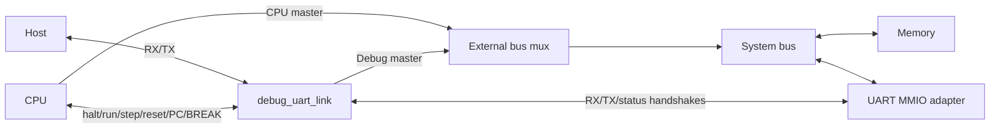

# Debug UART

Reusable, single-clock RTL for a shared **115200-baud, 8N1 UART** carrying both
seven-bit application data and bidirectional debug traffic. It includes one CPU
RX register, one pending CPU TX byte, a debug master and an unbuffered UART
transmitter. The CPU, bus arbiter, memory map, board pins and clock generation
are external to this component. No Prim opcodes or iCE40-specific primitives
are required by the RTL in this directory.

- [Register and handshake reference](docs/register_interface.md): RX, TX,
  status, reset, bus-adapter contracts and software examples.
- [Top-level RTL interface](#rtl-interface): all ports of `debug_uart_link`.
- [Debug wire protocol](#debug-wire-protocol): commands, responses and pacing.
- [Host library and console](#host-library-and-console).
- [Validation and limits](#validation-and-limits).

The following is the implemented interface. [initial_design.md](docs/initial_design.md)
is historical and superseded. [The project protocol](../docs/DRAFT.md) adds
Prim-specific system/board context; this README and the register reference
contain the information needed to integrate the UART in another project.

## Components and source files

Use `rtl/debug_uart_link.v` as the complete RTL entrypoint and include all six
Verilog files below in synthesis/simulation:

| File/module | Responsibility |
|---|---|
| [`debug_uart_link`](rtl/debug_uart_link.v) | Connect PHY, CPU buffers, debug controller and TX arbiter |
| [`uart_rx`](rtl/uart_rx.v) | Two input synchronizer flops and one bit-centre sample per bit |
| [`uart_tx`](rtl/uart_tx.v) | Frame transmitter with valid/ready handshake |
| [`uart_buffers`](rtl/uart_buffers.v) | Retained seven-bit RX data/received flag and pending seven-bit TX data/valid flag |
| [`debug_uart`](rtl/debug_uart.v) | Command parser, pointer, master requests, replies and pending BREAK notification |
| [`uart_arbiter`](rtl/uart_arbiter.v) | Debug priority when the transmitter accepts its next byte |

For a smaller application without the debug protocol, these building blocks
can be instantiated separately. `uart_buffers.o_csr` has the same bit layout
as `debug_uart_link.o_uart_csr`. The low-level `uart_tx` accepts eight data
bits and has no channel encoding; the arbiter adds bit 7 = 0 to CPU output.
Do not also instantiate another receiver/transmitter on the same physical line.

## Clock, reset and serial format

`CLK_HZ` is the actual frequency of `i_clk` in Hz, default 100000000. All RTL
uses rising edges of this clock and synchronous, active-high `i_reset`. CPU
control/status, bus and buffer interfaces must belong to this same clock domain.
Only the serial `i_rx` input has its own two-flop synchronizer. Any other clock
crossing is the integrator's responsibility. The component does not generate
or gate clocks; a board PLL, if used, is external.

The constant divider is `(CLK_HZ + 57600) / 115200`. Baud is fixed, not runtime
programmable. Actual baud is `CLK_HZ / divider`:

| Clock | Divider | Actual baud |
|---|---:|---:|
| 25 MHz | 217 | approximately 115207.37 |
| 100 MHz | 868 | approximately 115207.37 |

Choose a clock/divider compatible with bit-centre sampling and the peer's baud
tolerance. RX tests cover dividers 8, 9, 17 and 868; board simulation also uses
217. Invalid/too-small dividers are not diagnosed. TX-only tests at divider 1
are not a guarantee of RX operation at that divider.

The line is idle high, with one low start bit, eight data bits LSB first and
one high stop bit. There is no parity or RTS/CTS. Use the target's appropriate
IO voltage and board constraints; those are outside this module.

## RTL interface

All directions below are relative to `debug_uart_link`.

| Port | Direction/width | Contract |
|---|---|---|
| `i_clk` | input, 1 | Shared system clock |
| `i_reset` | input, 1 | Synchronous module reset; also forces TX idle and disables TX acceptance |
| `i_rx` | input, 1 | Asynchronous serial input; keep high when unused |
| `o_tx` | output, 1 | Serial output |
| `i_output_data` | input, 7 | CPU/application byte to enqueue |
| `i_output_valid` | input, 1 | Producer holds valid/data until ready handshake |
| `o_output_ready` | output, 1 | CPU TX slot can accept a byte; low during reset |
| `o_input_data` | output, 7 | Most recently received CPU byte, retained after consumption |
| `i_input_read` | input, 1 | Consume RX on this edge: clear received flag, keep data |
| `o_uart_csr` | output, 4 | Bit 0 RXAVAIL; bit 1 TXFREE; bit 2 RXIE; bit 3 TXIE |
| `i_csr_data` | input, 8 | CSR write byte; only bits 2/3 are writable |
| `i_csr_write` | input, 1 | Update interrupt enables at the completed CSR write |
| `o_irq` | output, 1 | Synchronous pulse on enabled CPU RX / TX slot release events |
| `o_halt` | output, 1 | Halt request held until CPU confirms halt |
| `o_run` | output, 1 | One-clock resume pulse |
| `o_step` | output, 1 | One-clock single-instruction request |
| `o_reset_cpu` | output, 1 | One-clock CPU-only reset request after confirmed halt |
| `i_halted` | input, 1 | Confirmed CPU halt, with CPU memory bus inactive |
| `i_pc` | input, 16 | Next instruction address, valid at confirmed halt |
| `i_break_reason` | input, 1 | Stored CPU BREAK reason, cleared by RUN or CPU reset |
| `i_break_event` | input, 1 | One-clock notification of a new BREAK |
| `o_addr` | output, 16 | Debug master byte address |
| `o_data` | output, 16 | Debug master write data |
| `o_bs` | output, 2 | 00 idle, 01 byte, 11 word; the debug master does not issue 10 |
| `o_we` | output, 1 | Write enable; meaningful only with nonzero BS |
| `i_ack` | input, 1 | Complete the selected debug request at this edge |
| `i_data` | input, 16 | Debug read result, valid at ACK |

The [register reference](docs/register_interface.md) specifies the exact buffer
edge cases. `o_uart_csr[1]` is **not** physical TX idle. No physical-idle
status output, overflow flag or FIFO depth parameter exists. RXIE/TXIE enable
event pulses on `o_irq`; see the register reference for timing and reset rules.

## Integration



Inside a SoC, connect the complete module as follows. Signal names on the right
are integration nets supplied by the surrounding CPU, arbiter and MMIO adapter:

```verilog
debug_uart_link #(.CLK_HZ(25000000)) uart (
    .i_clk(clk), .i_reset(system_reset), .i_rx(serial_rx), .o_tx(serial_tx),
    .i_output_data(uart_tx_data), .i_output_valid(uart_tx_valid),
    .o_output_ready(uart_tx_ready),
    .o_input_data(uart_rx_data), .i_input_read(uart_rx_consume),
    .o_uart_csr(uart_csr),
    .i_csr_data(uart_csr_data), .i_csr_write(uart_csr_write), .o_irq(uart_irq),
    .o_halt(cpu_halt_request), .o_run(cpu_run), .o_step(cpu_step),
    .o_reset_cpu(cpu_reset_halt), .i_halted(cpu_halted),
    .i_pc(cpu_next_pc), .i_break_reason(cpu_break_reason),
    .i_break_event(cpu_break_event),
    .o_addr(debug_addr), .o_data(debug_write_data),
    .o_bs(debug_bs), .o_we(debug_we),
    .i_ack(debug_ack), .i_data(debug_read_data)
);
```

The external CPU integration must implement these semantics:

- HALT finishes the current instruction and all its bus waits, then stops before
  the next fetch. Assert `i_halted` only when the CPU bus is inactive.
- RUN resumes at the current PC and clears the stored BREAK reason. STEP, issued
  only at halt, executes exactly one instruction and returns to halt. Its halt
  indication must deassert while the instruction is executing.
- `o_reset_cpu` resets only the CPU and leaves it halted at its reset PC. Do not
  feed this pulse back into `i_reset`: UART, buffers and debug pointer must survive.
- A BREAK advances PC to the following instruction, retains its reason, and emits
  one synchronous `i_break_event` pulse. The module separately retains that
  notification until TX accepts it. Its pending bit is not the stored CPU reason.
  RUN/CPU-only reset can clear the reason without cancelling a pending notification.
- Reset the CPU as required by the surrounding system. `i_reset` by itself resets
  the UART/debug component; it does not emit an automatic CPU-reset command.

Arbitrate the bus **outside** the module. Grant debug ownership only on confirmed
`i_halted`; route ACK/read data from the selected target and prevent ACK intended
for the CPU from completing a debug request. Keep all request signals stable
through ACK. Decode requests from nonzero BS, never from WE alone: WE and other
idle outputs need not be zero. Do not change bus ownership during an access.
Word, unaligned, wrapping and MMIO side effects are properties of the external
bus adapter. A debug word request is a word operation, not two debug byte requests.

[`prim_system.v`](../system/rtl/prim_system.v), [`bus_mux.v`](../system/rtl/bus_mux.v)
and [`memory_io.v`](../system/rtl/memory_io.v) show a complete integration. The
[address map and word-lane rules](../system/docs/uart_mmio.md) belong to that
system; they are not hardwired into `debug_uart_link`.

## Debug wire protocol

Bit 7 identifies the channel independently for every byte in both directions:

| Wire byte | Meaning |
|---|---|
| `0xxxxxxx` | CPU/application data, seven payload bits |
| `1xxxxxxx` | Debug ASCII, with bit 7 additionally set |

No separate bit-6 control encoding exists. CPU data are not UTF-8 transparent.
For example, debug `q` is wire byte F1 and reply `K2` is CB B2. CPU character
`K` is 4B and cannot be mistaken for its debug counterpart CB.

Numbers use lowercase hex, **least-significant nibble first**: `12` means 21h,
`1234` means 4321h, `12ab` means BA21h. Responses use the same encoding with
fixed width. In this table characters are shown without the extra channel bit:

| Command | Preconditions/effect | Response |
|---|---|---|
| `H` | Request halt; already-halted CPU is also acknowledged | `K` after confirmed halt |
| `G` | Resume at current PC | `K` |
| `S` | CPU halted; execute exactly one instruction | `K` after renewed halt |
| `Z` | Halt, then reset only CPU and remain halted | `K` |
| `P` | CPU halted; read next instruction address | `K` + 4 hex digits |
| `?` | CPU status; terminate previous parser mode | `T` + 1 hex digit |
| `q` | UART status, including while CPU runs; no bus access | `K` + 1 hex digit |
| `A` + 1..4 hex digits | Replace only the specified low pointer nibbles | none |
| `r` | CPU halted; read byte at pointer | `K` + 2 hex digits |
| `R` | CPU halted; read word at pointer | `K` + 4 hex digits |
| `w` | CPU halted; enter persistent byte-write mode | `K` after each completed value |
| `W` | CPU halted; enter persistent word-write mode | `K` after each completed value |

`?` bit 0 is CPU halted, bit 1 stored BREAK reason, bits 3:2 zero. `q` bit 0 is
CPU RX received, bit 1 CPU TX buffer free, bits 3:2 zero. The two status formats
are distinct; neither query consumes CPU RX data.

The pointer resets to 0000 on module reset, not on CPU-only reset. `A12ab` sets
BA21; then `Aa` changes it to BA2A, `A4c` to BAC4. Higher nibbles are retained
when omitted. Always send four digits when setting an absolute address from a
host program. A following command terminates address input; a pause never does.
`A0010r` reads at 0100. `A` never accesses the bus or produces an acknowledgment.

Each `r`/`R` initiates one transfer. A write value needs two digits in `w` or
four in `W`. For example: send `w12`, wait for `K`, send `34`, wait for `K`.
This writes bytes 21h and 43h without another `w`. Write prefixes alone produce
no reply. After ACK, the pointer advances by one/two for byte/word operations,
modulo 65536. It does not advance on request start or UART transmission.

Every new command ends the previous address/write mode and discards incomplete
input. In particular, `q` must not be interleaved into a persistent write burst;
resume with a fresh `w`/`W` after switching commands. A started bus access cannot
be aborted. The host must not send new debug commands or write values until the
outstanding reply has completed. `?` is parser synchronization, not cancellation
of a stuck bus transfer. CPU-channel bytes may still arrive during a debug
operation and are handled independently by the RX register.

An asynchronous BREAK sends `B` once, before or after a complete debug reply,
never inside one. STEP on BREAK produces both `K` and `B`, in either order.
CPU-channel output may appear among debug bytes and is separated by bit 7.
Debug replies and BREAK beat pending CPU output at each TX byte boundary; the
current frame is never preempted. Unlimited debug traffic can starve CPU TX.
Only one pending BREAK bit and one debug operation are stored; this is not an
event queue or command FIFO. Correct host pacing and CPU control must prevent
multiple unsent BREAK events accumulating.

## Host library and console

Installing the root Python project installs `python/prim_debug_uart/`:

```sh
python -m pip install -e . pyserial
```

For reuse without the compiler package, put `debug_uart/python/` on the Python
module search path, or package `prim_debug_uart` in the consuming project:

```sh
python -m pip install pyserial
PYTHONPATH=/path/to/debug_uart/python python your_host.py
```

The implementation uses the standard library; `connect()` additionally needs
pyserial. The compatibility import `prim.debug_uart` belongs to the Prim package.

`prim_debug_uart.DebugUART` is blocking. It demultiplexes CPU output and BREAK
only while awaiting debug replies; it does not monitor an idle connection.
It offers `halt`, `run`, `step`, `reset_halt`, `status`, `uart_status`, `read_pc`,
`set_address`, `read8`, `read16`, `write_bytes` and `write_words`. It does not
check all CPU-state preconditions. Its transport needs bounded reads. A positive
response timeout uses a monotonic clock. Timeout is not a hardware bus abort.

`write_words_stream(values, address=None, write_delay=0, on_progress=None)` is a
separate SRAM-loading operation: a sender writes ahead while replies are counted
concurrently. `on_progress` receives the count of acknowledged words. It relaxes
the normal wait-per-value rule and can lose input during bus stalls. The optional
delay is in seconds, after draining each word to the UART. Missing/invalid OKs
raise an error without retry; discard the connection and manually reload the
whole image. Matching counts alone are not a readback check. The ordinary
`write_words` and `write_bytes` keep their per-value handshake. `UARTSession`
keeps CPU/BREAK reception active and excludes credit polls throughout a stream;
a streaming error invalidates that session so late replies cannot leak into
later commands. No FPGA FIFO or protocol bytes were added.

For simultaneous application/debug traffic use
`prim_debug_uart.session.UARTSession`, a context manager with one continuous RX
thread and a separate CPU-input sender. Example, assuming the application has
already been loaded and is running:

```python
import sys
from prim_debug_uart.session import UARTSession

def show_output(data):
    sys.stdout.buffer.write(data)
    sys.stdout.buffer.flush()

with UARTSession.connect('/dev/serial/by-id/your-adapter', timeout=2.0,
                         on_output=show_output,
                         on_break=lambda: print('[BREAK]', file=sys.stderr)) as uart:
    uart.queue_cpu(b'help\r')
    print(uart.status(), file=sys.stderr)  # works alongside application traffic
    input('Enter to close the host connection: ')
```

`queue_cpu()` is asynchronous and rejects bytes with bit 7 set. For each byte,
the sender queries `q`, waits for RX received = 0, then sends exactly one CPU
byte. While RX is full it releases the debug transaction lock, allowing RUN or
other debug controls to proceed. Do not send several bytes on the same credit.
Keep the connection open until needed; closing discards unsent queued input.
CPU execution halted means it cannot consume input, not that debug RX is blocked.

Debug methods are serialized by a reentrant transaction lock, including entire
persistent write bursts. Use `uart.transact(operation)` to serialize a sequence
of methods, such as a load, against credit polls and other debug operations.
Reader callbacks must not block or start debug operations. CPU output is streamed
without retention when `on_output` is supplied; otherwise it accumulates in
`output`. BREAK increments `break_events` and invokes `on_break`. Response
timeout, invalid reply or reader failure stops the session to avoid consuming
a late response as the next command's reply. Close and reconnect after resolving
the underlying operation; reconnecting does not cancel an active FPGA bus access.

The reusable POSIX terminal UI is `prim_debug_uart.console.Console`; the Prim
board command adapter is `boards/olimex_ice40hx8k_evb/host.py`:

```sh
python boards/olimex_ice40hx8k_evb/host.py console --help
python boards/olimex_ice40hx8k_evb/host.py --port "$PORT" console
```

Ctrl+B opens local commands, Ctrl+D quits either mode without HALT/RESET, Ctrl+V
quotes the next CPU byte, and empty Enter in the prompt returns to CPU mode.
Up/Down browses submitted commands in the debug prompt. Moving down past the
newest entry restores the unfinished input. History lasts for the console session.
Normal Enter goes to the CPU. Raw terminal input distinguishes Enter (CR) from
Ctrl+B (STX); terminal attributes are restored on exit. `help` or `?` lists
all commands. CPU output and BREAK remain active while entering commands,
displaying help, loading images, or waiting for replies. The command adapter
can be replaced for another project's image format and CPU controls.

The debug prompt supports `read <addr> [len]` for a hex dump with addresses,
16 bytes per line and an ASCII column (nonprintable bytes appear as `.`).
Omitting `len` reads one byte. `write <addr> <bytes...>` writes consecutive
bytes. All numbers are decimal unless prefixed with `0x`; for example,
`read 0x2000 32` and `write 0x2000 65 0x42 255`. Addresses must fit in
16 bits, bytes in 8 bits, and ranges must not wrap past `0xFFFF`.
These commands also work as host CLI subcommands and access the specified
addresses directly, including MMIO, without changing the CPU run/halt state.

## Validation and limits

From the repository root with the Python package installed:

```sh
python debug_uart/tests/test_rtl.py
python debug_uart/tests/test_host.py
python debug_uart/tests/test_session.py
python system/tests/test_debug_uart.py
python system/tests/test_io.py
python cpu/tests/test_debug_cpu.py
```

These cover PHY RX/TX, buffer reset/overflow/retention, same-edge RX/read,
arbitration, parser/number encoding, bus waits and word lanes, HALT/STEP/BREAK,
CPU echo with concurrent debug traffic, MMIO/OK deadlock freedom, credit pacing,
persistent debug writes, continuous output/BREAK, and terminal keybindings and
restoration through a pseudoterminal. Shared test helpers live in `tests/support/`
at the project root and are not runtime dependencies of the module.

There are no CRCs, retries, RX/ACK timeouts in FPGA logic, framing-error reports,
error replies, interrupt output, receive FIFO, command queue or overrun flag.
Unknown debug characters may be ignored. Incomplete address/data input can wait
forever. Incorrect command pacing, excess address digits, or RX overwrite is
not diagnosed/repaired. Host response timeouts are software-only. Pin assignment,
external memory timing, clock constraints and hardware verification remain the
integrator's work; see the board documentation for this project's build results.
