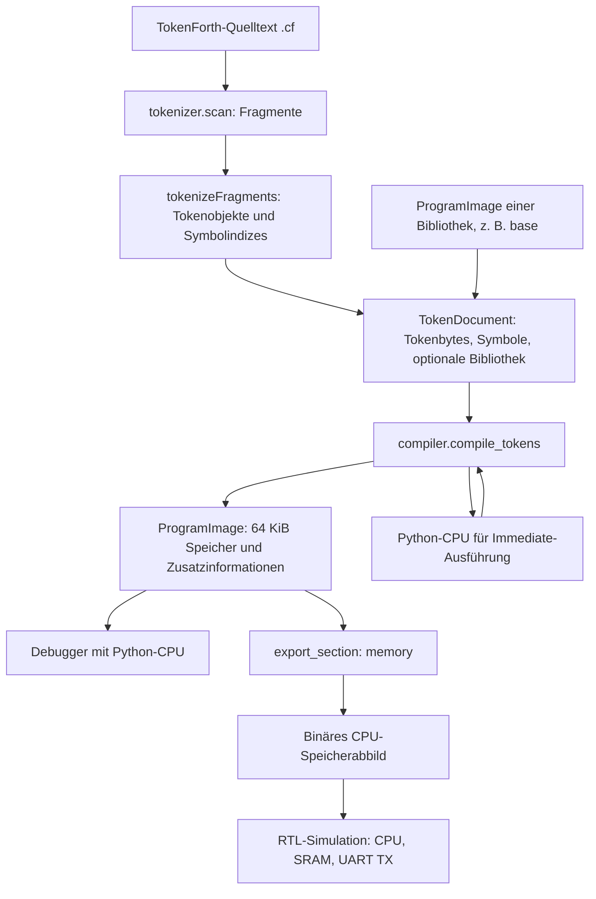
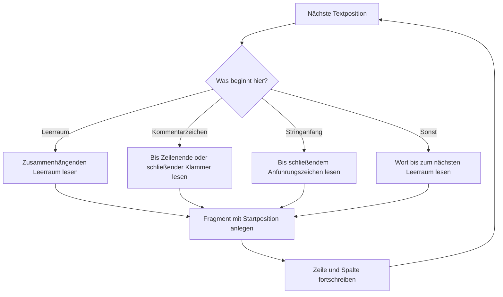
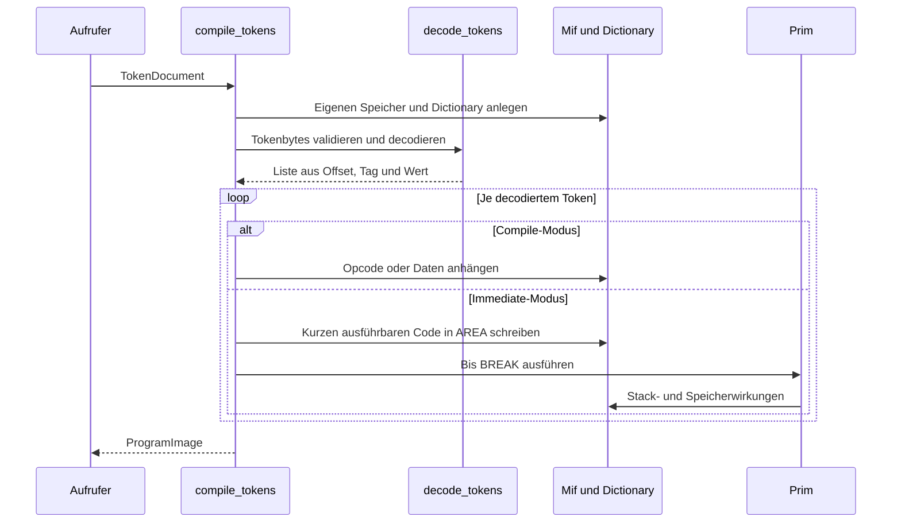
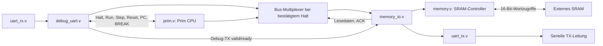
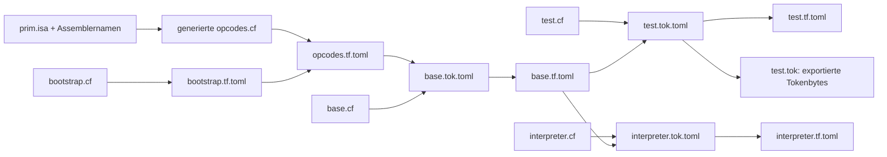

# Code und Architektur

Diese Dokumentation beschreibt den aktuellen Code: wie TokenForth-Quelltext zu
CPU-Code wird, welche Daten die Werkzeuge austauschen und wie Python und RTL
zusammenhängen. Die [Testdokumentation](TESTS.md) steht separat.
[Entscheidungen](DECISIONS.md) erklären die Anforderungen und ihre Gründe;
[Projektwissen](PROJECT_KNOWLEDGE.md) enthält den kompakten Projektüberblick.

## 1. Das Gesamtsystem

Prim besteht aus einer Stack-CPU und der darauf aufbauenden Sprache TokenForth.
Die Python-Werkzeuge übersetzen Quelltext auf dem Entwicklungsrechner. Das
Ergebnis kann die Python-CPU oder die Verilog-CPU ausführen.



Tokenbytes und CPU-Code sind verschiedene Formate. Beispielsweise enthält ein
Wortaufruf im Tokenstrom einen **Symbolindex**, im erzeugten CPU-Code dagegen
eine **Speicheradresse** plus `CALL`. Ein `.tok`-Export der Sektion `tokens`
ist daher kein direkt ausführbares CPU-Programm.

## 2. Orientierung im Repository

| Datei / Verzeichnis | Aufgabe |
| --- | --- |
| [src/prim/tokenizer.py](../src/prim/tokenizer.py) | Scanner, Sprachkonstrukte erkennen, Symbolnamen auflösen |
| [src/prim/tokens.py](../src/prim/tokens.py) | Tokenarten, Tokenobjekte und Bytecodierung |
| [src/prim/compiler.py](../src/prim/compiler.py) | Tokenstrom decodieren, Code/Daten erzeugen, Immediate-Code ausführen |
| [src/prim/artifacts.py](../src/prim/artifacts.py) | Dokumentmodelle, Validierung, TOML und Binärexport |
| [src/prim/errors.py](../src/prim/errors.py) | `CompileError` mit Quellposition oder Tokenoffset |
| [src/prim/isa.py](../src/prim/isa.py) | Opcodes, Speicherlayout-Konstanten, Verilog- und TokenForth-Export |
| [src/prim/cpu.py](../src/prim/cpu.py) | Ausführbare CPU-Referenz und `MemoryIf` |
| [src/prim/assembler.py](../src/prim/assembler.py) | Assembler und einfache Binärdisassemblierung |
| [src/prim/disassembler.py](../src/prim/disassembler.py) | Disassemblierung mit Symbolen und Literalinformationen |
| [src/prim/debugger.py](../src/prim/debugger.py) | Terminaloberfläche, Breakpoints, Speicheransicht und UART RX |
| [src/prim/cli.py](../src/prim/cli.py) | Unterbefehle an die jeweiligen Module weiterleiten |
| [src/prim/exporter.py](../src/prim/exporter.py) | Gewählte Dokumentsektion als Bytes exportieren |
| [src/bootstrap.cf](../src/bootstrap.cf) | Minimale Codeerzeugung: `c,` und `,` |
| [src/base.cf](../src/base.cf) | In TokenForth geschriebene Basis- und Codeerzeugungswörter |
| [src/interpreter.cf](../src/interpreter.cf) | Unvollständiger Token-Interpreter zur Ausführung auf der CPU |
| [src/Makefile](../src/Makefile) | Basisbibliothek, Testprogramm und Interpreter bauen |
| [rtl/](../rtl/) | Verilog-CPU, SRAM-Anbindung und UART-Sender |
| [rtl/sim_support/](../rtl/sim_support/) | Simulations- und Vergleichsinfrastruktur; siehe Testdoku |
| [hdl/](../hdl/) | Alternative Amaranth-Implementierung, außerhalb des aktuellen Arbeitsumfangs |

Die Implementierungen leben im Paket `prim`; die alten Python-Skriptwrapper
sind entfernt. `__main__.py` ruft den CLI-Dispatcher auf. `__init__.py` stellt
unter anderem `Prim`, `MemoryIf` und `PrimAsm` bei Bedarf bereit, ohne optionale
Debugger- oder HDL-Abhängigkeiten automatisch zu laden.

## 3. Was bedeutet hier „Parser“?

Es gibt keinen separaten Parser mit Grammatikdatei, Operatorpräzedenz oder
abstraktem Syntaxbaum. TokenForth ist eine durch Leerraum getrennte Sprache.
Die Verarbeitung ist in drei Schritte aufgeteilt:

1. **Lexikalische Zerlegung:** `scan()` findet Wortgrenzen, Strings und Kommentare.
2. **Erkennen und Auflösen:** `tokenizeFragments()` bestimmt die Bedeutung eines
   Fragments, verwaltet den Modus und löst Wortnamen in Symbolindizes auf.
3. **Tokenverarbeitung:** `decode_tokens()` prüft das Byteformat;
   `interpret()` führt die Übersetzungsaktionen aus.

`argparse` in den `main()`-Funktionen ist davon unabhängig: Es verarbeitet die
Kommandozeilenoptionen, nicht den TokenForth-Quelltext. `tomllib` liest wiederum
die TOML-Dokumente zwischen den Werkzeugen.

## 4. Scanner: Text wird zu Fragmenten

`scan(source, filename)` läuft mit einem Positionszeiger einmal durch den Text.
Jedes `Fragment` enthält den Originaltext `s`, `kind`, Dateiname, Zeile und
Spalte. Diese Position wird später für Fehlermeldungen verwendet.



Die konkrete Erkennung erfolgt in dieser Reihenfolge:

| Beginn | Fragmentart | Regel |
| --- | --- | --- |
| Leerzeichen, Tab, Zeilenumbruch | `whitespace` | Zusammenhängender Leerraum |
| `\` mit folgendem Leerraum oder Dateiende | `line_comment` | Bis vor den nächsten Zeilenumbruch |
| `(` mit folgendem Leerraum, `)` oder Dateiende | `comment` | Bis zum ersten `)`; mehrzeilig, nicht verschachtelt |
| `"` | `string` | Einzeiliger String |
| `#"` | `raw_string` | Einzeiliger Datenstring |
| Sonstiger Text | `word` | Bis zum nächsten Leerraum |

Innerhalb eines Strings sind Kommentarzeichen normale Daten. Innerhalb eines
Kommentars eröffnen Anführungszeichen keinen String. Backslashes in Strings
sind wörtlich gemeint; es gibt keine Escape-Syntax wie `\n` oder `\"`.
Nach einem geschlossenen String oder Klammerkommentar muss Leerraum oder
Dateiende folgen. Ein offener String oder Kommentar führt zu `CompileError`.

Beispiel:

```forth
:inc 1 + ; \ erhöht den obersten Stackwert
```

Der Scanner erkennt hier unter anderem die Wörter `:inc`, `1`, `+`, `;`,
dazwischen Leerraum und am Ende einen Zeilenkommentar. Er entscheidet noch
nicht, dass `+` ein CPU-Mnemonic und `:inc` eine Definition ist.

## 5. Tokenizer: Fragmente erhalten Bedeutung

### Symboltabelle und Erkennungsreihenfolge

`SymbolTable` hält eine geordnete Namensliste und eine Abbildung Name → Index.
Standardmäßig beginnen die Symbole mit `H` und `LATEST`. Bei einer importierten
Bibliothek wird deren Symbolfolge übernommen und für neue Definitionen erweitert.

`tokenizeFragments()` verarbeitet die Fragmente in Quellreihenfolge. Es erkennt
zuerst Leerraum, Kommentare und Strings, danach Moduswechsel und Definitionen,
anschließend Mnemonics, eingebaute Wörter, Literale, Wortadressen, bekannte
Wortnamen und schließlich Zahlen. Diese Reihenfolge entscheidet bei Konflikten:
Ein Mnemonic hat beispielsweise Vorrang vor einem gleich geschriebenen Wort.
Mnemonic-Erkennung ignoriert Groß-/Kleinschreibung; Symbolnamen werden exakt
verglichen.

| Quelltext | Tokenart | Bedeutung |
| --- | --- | --- |
| `:inc` | `DEFINITION` | Namen registrieren und Definitionsmarke erzeugen |
| `inc` | `WORD_CALL` | Index eines bekannten Wortes |
| `'inc` | `WORD_ADDRESS` | Index eines Wortes, dessen Adresse benötigt wird |
| `42`, `$2a`, `0x2a` | `NUMBER` | 16-Bit-Zahlenwert |
| `"Text"` | `STRING` | String mit Laufzeitcode für seine Adresse |
| `+`, `dup`, `nop.ret` | `MNEMONIC` | Ein CPU-Opcode |
| `;` | `BUILDIN` | Eingebautes Wort; aktuell `NOP.RET` |
| `#42` | `LIT_NUMBER` | Zahl als rohe 16-Bit-Daten |
| `#inc` | `LIT_ADDRESS` | Adresse des Wortes als rohe 16-Bit-Daten |
| `#"Text"` | `LIT_STRING` | String als rohe Daten |
| `[` / `]` | `MODE` | Immediate-Modus beginnen / beenden |

Ein Name muss beim Verweis bereits bekannt sein. Vorwärtsreferenzen auf später
definierte Wörter werden nicht automatisch aufgelöst. Doppelte oder leere
Definitionen und unbekannte Wörter sind Fehler. Der Zahlenwert wird bei der
Tokencodierung auf seine unteren 16 Bits abgebildet.

### Modusprüfung

`[` aktiviert den Immediate-Modus; `]` schaltet zurück in den Compile-Modus.
Verschachtelung, ein einzelnes `]` und ein fehlendes abschließendes `]` werden
bereits im Tokenizer erkannt. Definitionen, Strings und rohe Literale sind im
Immediate-Modus nicht erlaubt. Wortaufrufe, Wortadressen, Zahlen und Mnemonics
bleiben erlaubt.

### Tokenobjekte und Byteformat

Die Klassen in `tokens.py` speichern Tokenart und Nutzlast. Ihre Methode
`generate()` erzeugt die Bytes. `tokenize_text()` sammelt sie in einem
`TokenizedSource`; `tokenize_document()` verpackt sie anschließend zusammen
mit Symbolen und optionalem Bibliotheksspeicher in ein `TokenDocument`.

| Tag | Art | Bytes nach dem Tag |
| --- | --- | --- |
| 0 | `WORD_CALL` | Symbolindex: Low-Byte, High-Byte |
| 1 | `WORD_ADDRESS` | Symbolindex: Low-Byte, High-Byte |
| 2 | `NUMBER` | Wert: Low-Byte, High-Byte |
| 3 | `STRING` | Byteanzahl, UTF-8-Bytes |
| 4 | `MNEMONIC` | Opcode |
| 5 | `BUILDIN` | Index in `BuildIn.BUILDINS` |
| 6 | `LIT_NUMBER` | Wert: Low-Byte, High-Byte |
| 7 | `LIT_STRING` | Byteanzahl, UTF-8-Bytes |
| 8 | `LIT_ADDRESS` | Symbolindex: Low-Byte, High-Byte |
| 9 | `DEFINITION` | Byteanzahl, UTF-8-Bytes des Namens |
| 10 | `MODE` | 0 = Compile, 1 = Immediate |
| 11 / 12 / 13 | Klammerkommentar / Zeilenkommentar / Leerraum | Byteanzahl, UTF-8-Bytes |

Die Längenangabe ist ein Byte: Alle so codierten Texte, auch Namen, Kommentare
und Leerraumfragmente, sind auf 255 UTF-8-Bytes begrenzt. Ein einzelnes normales
Leerzeichen wird nicht als Token gespeichert; Quelltext ist daher nicht in jeder
Hinsicht bytegenau aus dem Tokenstrom rekonstruierbar. Der Compiler ignoriert
Kommentar- und Leerraumtokens.

## 6. Dokumente und Datei-I/O

`artifacts.py` bildet die gemeinsame Grenze zwischen Dateiformat und Werkzeugen.
Die Dateien `.tok.toml` und `.tf.toml` sind TOML-Dokumente mit unterschiedlichen
Rollen:

| Feld | `TokenDocument`, `type = "tokenizer"` | `ProgramImage`, `type = "tokenforth"` |
| --- | --- | --- |
| `symbols` | Geordnete Symbolnamen | Dieselbe Indexbasis für das Dictionary |
| `tokens` | Codierter Tokenstrom | Nicht erlaubt |
| `memory` | Leer oder importiertes 64-KiB-Abbild | Genau 65536 Bytes |
| `string-literals` | Übernommene Stringadressen | Adressen von Längenbytes der Datenstrings |
| `num-literals` | Übernommene Literaladressen | Adressen roher 16-Bit-Daten |
| Weitere Felder | Metadaten wie Titel und Datum | Metadaten wie Titel und Datum |

Die Dataclasses sind `frozen`. Bytepuffer werden zu `bytes`, Symbol- und
Adresslisten zu Tupeln. Metadaten werden tief kopiert, bleiben innerhalb des
Dokuments aber ein veränderbares Dictionary. `to_mapping()` liefert unabhängige
Listen und Metadaten; es gibt keine gemeinsam genutzten Eingabepuffer.

`load_tokens()` und `load_program()` prüfen Dokumentrolle und Struktur.
`tomllib` liest TOML; `tomli_w` schreibt es. `save()` serialisiert vor dem Öffnen
der Ausgabedatei, damit Serialisierungsfehler keine vorhandene Datei abschneiden.
Die semantische Prüfung der Tokenbytes bleibt Aufgabe des Compilers.

`export_section()` schreibt eine Bytefolge direkt in eine Binärdatei:
`memory` exportiert CPU-Speicher, `tokens` einen Tokenstrom. Das Dateisuffix
allein legt den Inhalt nicht fest.

## 7. Compiler: Tokenbytes werden zu Code und Daten

### Einstieg und Zustandsbesitz

`compile_tokens(document)` erstellt einen neuen `Mif`, ein eigenes `Dictionary`
und eine `Prim`-CPU. Eine importierte Bibliothek liefert Ausgangsspeicher,
Symbolnamen und Literaladressen. Ohne Bibliothek initialisiert `init()` die
Verwaltungszellen. Am Ende entsteht ein unabhängiges `ProgramImage`.



`decode_tokens()` prüft Bytewerte, bekannte Tags, Nutzlastlängen, UTF-8,
Moduswerte und Builtin-Indizes. Es decodiert den gesamten Strom vor Beginn der
Übersetzungsaktionen. Sein Ergebnis enthält Byteoffsets für Fehlermeldungen.
`interpret()` verarbeitet anschließend die Bedeutung der Tokens.

### Symbolindex, Dictionary und Speicheradresse

Die Namensliste ist noch kein Adressverzeichnis. Die tatsächlichen Wortadressen
stehen als 16-Bit-Werte im emulierten Speicher:

```text
symbols[index]              Dictionaryzelle                  Inhalt
H          [0]              0xfefe - 2 * 0 = 0xfefe           0x000a
LATEST     [1]              0xfefe - 2 * 1 = 0xfefc           0x000c
inc        [2]              0xfefe - 2 * 2 = 0xfefa           Adresse von inc
main       [3]              0xfefe - 2 * 3 = 0xfef8           Adresse von main
```

`fetchFromIndex()` liest die Zelle zu einem Symbolindex. Bei `DEFINITION`
speichert `appendToIndex()` den aktuellen HERE-Wert in der nächsten freien
Dictionaryzelle und verschiebt LATEST um zwei Bytes nach unten.

```text
Niedrige Adressen
0x0000 ... 0x0009   Platz für Startcode / niedrige Speicheradressen
0x000a ... 0x000b   H: HERE, Adresse des nächsten freien Code-/Datenbytes
0x000c ... 0x000d   LATEST: Adresse der nächsten freien Dictionaryzelle
0x000e ...         Code und Daten wachsen aufwärts
        ↓
        freier Bereich
        ↑
... 0xfefa         Dictionary wächst abwärts
0xfefc             Dictionaryeintrag für LATEST
0xfefe             Dictionaryeintrag für H
0xff00 ...         AREA: temporärer Code für Immediate-Ausführung
0xfffe / 0xffff     im Debugger zusätzlich UART-RX-Register
Hohe Adressen
```

`comma()` hängt Bytes an HERE an, `comma16()` ein Little-Endian-Wort.
CPU-Adressen laufen bei 16 Bits über; zusätzliche Compilerprüfungen gegen
Code-/Dictionarykollisionen sind derzeit nicht implementiert (D13).

### Compile-Modus

| Token | Übersetzungsaktion |
| --- | --- |
| `NUMBER` | `PUSH8 wert`, wenn kleiner als 256, sonst `PUSH lo hi` |
| `WORD_ADDRESS` | Adresse aus dem Dictionary laden und PUSH-Code erzeugen |
| `WORD_CALL` | Wie Wortadresse, danach `CALL` anhängen |
| `MNEMONIC` | Opcode direkt anhängen |
| `BUILDIN` | Eingebaute Expansion assemblieren; `;` ergibt `NOP.RET` |
| `DEFINITION` | Aktuelles HERE als Wortadresse eintragen |
| `LIT_NUMBER` / `LIT_ADDRESS` | Rohes 16-Bit-Wort anhängen und Literaladresse merken |
| `LIT_STRING` | Länge und UTF-8-Bytes direkt anhängen |
| `STRING` | PUSH der Stringadresse, Sprung über die Daten, dann Stringdaten |

Für einen normalen String erzeugt `compile_string()` dieses Layout:

```text
HERE + 0    PUSH16 (HERE + 7)             ; Adresse des Längenbytes
HERE + 3    PUSH16 (HERE + 7 + Datenlänge)
HERE + 6    JP                            ; Daten bei Ausführung überspringen
HERE + 7    Anzahl UTF-8-Bytes
HERE + 8    UTF-8-Bytes ...
            nächste Instruktion
```

`Datenlänge` umfasst dabei Längenbyte plus Textbytes. Ein roher String `#"..."`
enthält nur die Daten und keinen Sprung oder PUSH-Code.

### Immediate-Modus und die Basisbibliothek

Im Immediate-Modus werden die aus dem Token erzeugten Opcodes sofort auf der
Python-CPU ausgeführt. `execute()` schreibt sie nach `Consts.AREA = 0xff00`,
hängt `BREAK` an und setzt den PC dorthin. Stack und Speicher bleiben zwischen
diesen Ausführungen erhalten. Die Standardgrenze beträgt 100000 CPU-Schritte
je Ausführung einschließlich BREAK; der temporäre Code darf höchstens 238
Bytes vor dem abschließenden BREAK umfassen.

So können Wörter der Basisbibliothek während der Übersetzung Code schreiben.
Beispielsweise verändert `c,` in `bootstrap.cf` den Speicher an HERE und erhöht HERE.
`if`, `else`, `then`, `while` und `repeat` erzeugen Sprünge beziehungsweise
korrigieren zuvor angelegte Adressplatzhalter. Sie sind normale TokenForth-Wörter,
keine besonderen Python-Parserknoten. Deshalb stehen ihre Aufrufe bei der
Codeerzeugung in eckigen Klammern, zum Beispiel:

```forth
:choose [ if ] 1 [ else ] 2 [ then ] ;
```

Hier entsteht zur Laufzeit eine Verzweigung anhand eines Stackflags.
Ein Ausdruck wie `[ 2 ]` führt dagegen während des Übersetzens einen PUSH aus;
er schreibt allein noch keine Zahl in den späteren Programmcode.

### Generierte Opcodewörter

`isa.export_tokenforth_opcodes()` erzeugt für jeden Eintrag in `PrimOpcodes`
ein TokenForth-Wort. Der Name folgt dem Assembler-Mnemonic in Kleinschreibung
mit Komma: ADD wird `+,`, TO_R wird `>r,`, BYTE_FETCH wird `c@,`.
Der Export verwendet dafür die vorhandene `PrimAsm.INSTRUCTIONS`-Tabelle;
es gibt keine zweite manuell gepflegte Namensliste und keine Opcodewerte in
`base.cf`, die parallel zur ISA aktualisiert werden müssten.

```forth
\ Ausschnitt aus der generierten opcodes.cf
:call, $01 c, ;
:+, $0c c, ;
:push, $21 c, ;
:break, $22 c, ;
```

Jedes dieser Wörter schreibt genau ein Byte an HERE und erhöht HERE um eins.
`push,` schreibt insbesondere keinen Operanden; `[ 'main push, , call, ]`
erzeugt PUSH16 mit Wortadresse plus CALL. SIMEND wird ebenfalls exportiert,
bleibt aber ein Simulationsmarker. Das Returnbit ist kein eigenes Opcodewort.

Der Build kompiliert zuerst `bootstrap.cf` mit `c,` und `,`, dann die daraus
abhängigen generierten Opcodewörter und danach `base.cf`. Zusammengesetzte
Wörter wie `2>r,`, `2r>,`, `=,` und `2dup,` verbleiben in `base.cf` und
verwenden die generierten Einzelopcodewörter.

`boot!` nimmt eine Einsprungadresse vom Datenstack. Es sichert HERE auf dem
Return-Stack, setzt HERE auf null, schreibt `PUSH16 entry; CALL; BREAK` und
stellt HERE wieder her. Die Basisbibliothek und ihre Dictionarydaten bleiben
so an ihren bisherigen Positionen.

## 8. Ein kleines Programm durch alle Stufen

Mit importierter Basisbibliothek ist die übliche Schreibweise:

```forth
:inc 1 + ;
:main 41 inc ;
[ 'main boot! ]
```

Beim Tokenisieren dafür `-it build/src/base.tf.toml` angeben. Die Adressen
hängen dann vom Bibliotheksumfang ab; nach dem Aufruf von `main` steht 42 auf
dem Datenstack. Beispielprogramme verwenden diese Form.

Für den folgenden bytegenauen Durchgang wird bewusst auf eine importierte
Basisbibliothek verzichtet. Dadurch lassen sich die festen Anfangsadressen
und die von `boot!` gekapselten Low-Level-Schreibzugriffe direkt erklären:

```forth
:inc 1 + ;
:main 41 inc ;
[ 0x21 0 c! 'main 1 ! 1 3 c! 0x22 4 c! ]
```

1. Der Tokenizer legt `inc` als Symbol 2 und `main` als Symbol 3 an.
2. `:inc` beginnt nach der Initialisierung bei `0x000e`.
3. `1 + ;` erzeugt `20 01 0c 80`: PUSH8 1, ADD, NOP.RET.
4. `main` beginnt bei `0x0012`. `41 inc ;` erzeugt
   `20 29 20 0e 01 80`: PUSH8 41, PUSH8 inc-Adresse, CALL, NOP.RET.
5. Der Immediate-Block schreibt den Startcode an Adresse 0:
   `21 12 00 01 22`: PUSH16 main-Adresse, CALL, BREAK.
6. Nach CPU-Reset startet der PC bei 0. Die Ausführung ruft `main`, dann `inc`
   auf und hält beim BREAK mit 42 auf dem Datenstack.

Der Compiler erzeugt diesen Startsprung nicht automatisch. Ein Programm muss
seinen Einstieg selbst festlegen; die Beispiele unter `src/examples/` tun das
mit einem Immediate-Block. Eine bloße Definition von `main` reicht nicht aus.

Nach Speichern als `build/src/demo.cf`, vom Repository-Stamm aus:

```sh
source .venv/bin/activate
mkdir -p build/src
prim tokenize -i build/src/demo.cf -o build/src/demo.tok.toml
prim compile -i build/src/demo.tok.toml -o build/src/demo.tf.toml
prim debug -i build/src/demo.tf.toml
```

Alternativ lassen sich die Bibliotheksfunktionen ohne Zwischendateien verwenden:

```python
from prim.tokenizer import tokenize_document
from prim.compiler import compile_tokens

source = ":inc 1 + ;\n:main 41 inc ;\n[ 0x21 0 c! 'main 1 ! 1 3 c! 0x22 4 c! ]"
tokens = tokenize_document(source, filename="demo.cf")
image = compile_tokens(tokens, filename="demo.tok.toml")
```

## 9. CPU und Assembler

`Prim.step()` holt einen Opcode über `MemoryIf`, erhöht den PC und ruft
`execute()` auf. PUSH und PUSH8 lesen ihre zusätzlichen Bytes über den PC.
`execute()` implementiert ALU, Stackoperationen, Speicherzugriffe und Sprünge.

Die CPU besitzt Daten- und Return-Stack mit je 16 zirkulären Einträgen. `T()`
und `N()` liefern die obersten beiden Datenwerte, `R()` den obersten Returnwert.
`CALL` legt die Rücksprungadresse auf den Return-Stack. Das Returnbit eines
regulären Opcodes löst nach der Operation einen Rücksprung aus. CALL, JP, JZ
und INT ignorieren das Returnbit. ADD setzt Carry bei Überlauf, SUB bei Borrow;
Schiebeoperationen liefern das zuletzt herausgeschobene Bit gemäß D02.

`BREAK` und `SIMEND` sind Haltemarken für Werkzeuge und Simulationen.
`Prim.step()` liefert die Marke zurück; es beendet keine äußere Ausführungsschleife
von selbst. Der Debugger und die Simulationsharnesses entscheiden über den Halt.

`MemoryIf` trennt CPU und Umgebung. Der Compiler verwendet RAM plus eine
UART-TX-Ausgabe beim Schreiben nach `0xffff`; der Debugger ergänzt UART RX.
Die Testreferenz besitzt wiederum eine protokollierende Speicherimplementierung.
Ein Austausch des Speichermodells erfordert keine Änderung am CPU-Interpreter.

`PrimAsm.assemble()` nimmt eine durch Leerraum getrennte Instruktionsfolge an.
Zahlen werden zu PUSH-Instruktionen; `.RET` setzt Bit 7 des Opcodes. Der
Assembler hat keinen TokenForth-Dictionarymechanismus. `prim asm -d` zeigt
Binärcode; `prim disasm` verwendet zusätzlich Symbole und Literaladressen aus
einem `ProgramImage`, um Code und eingestreute Daten verständlicher darzustellen.

## 10. Debugger

Der Debugger besteht aus `Mif` für Speicher/UART und `PrimDebug` für
Darstellung, Eingaben, Breakpoints und Ausführung. Das Zusatzpaket `blessed`
übernimmt Terminalsteuerung und Tastatureingabe.

| Zugriff | Verhalten |
| --- | --- |
| `read8()` / `read16()` | CPU-Zugriff; Lesen von `0xffff` verbraucht RX-Daten |
| `peek8()` / `peek16()` | CPU-sichtbaren Wert anzeigen, ohne RX-Daten zu verbrauchen |
| `write8()` / `write16()` | RAM ändern oder bei `0xffff` UART TX auslösen |
| `uart_rx(byte)` | Ein geprüftes Byte in die RX-Warteschlange einreihen |

Alle Code-/Speicheransichten, Disassemblierung und der Befehl `r` nutzen Peek.
RX-Status bei `0xfffe` zeigt, ob Daten vorhanden sind; `0xffff` liefert das
nächste Byte. Diese Register sind eine Debugger-Erweiterung, keine derzeitige
RTL-RX-Hardware. `uart <text>` codiert UTF-8 ohne automatischen Zeilenumbruch.

Rechts führt eine Instruktion aus. Unten setzt bei einem CALL einen temporären
Breakpoint hinter den Aufruf und startet die Ausführung. `run` läuft bis BREAK,
Breakpoint oder Tasteneingabe. `reset` setzt CPU und Speicher zurück, stellt
den anfänglichen UART-Puffer wieder her und verwirft temporäre Breakpoints.
Benutzer-Breakpoints bleiben erhalten. Ohne `-u` startet RX leer; eine explizit
angegebene, nicht lesbare Datei ist ein Fehler.

## 11. Host-Compiler und On-CPU-Interpreter

Diese beiden Komponenten erfüllen verschiedene Aufgaben:

| Host-Compiler | On-CPU-Interpreter |
| --- | --- |
| `src/prim/compiler.py`, läuft in Python | `src/interpreter.cf`, läuft als Prim-Code |
| Liest ein vollständiges TokenDocument | Liest Tokenbytes über das emulierte UART RX |
| Übersetzt mit Python-Funktionen und Immediate-CPU | Verteilt Tags über eine Sprungtabelle auf Tokenhandler |
| Erzeugt ein ProgramImage | Soll Token auf der CPU interpretieren bzw. übersetzen |
| Wird für die Beispielprogramme verwendet | Enthält noch leere Handler und unvollständige Moduslogik |

Der Host-Compiler ist nicht bloß eine Hülle um `interpreter.cf` und benötigt
diesen Interpreter nicht. `make -C src` baut ihn als eigenes Programm.
`build/src/test.tok` enthält exportierte Tokenbytes für seine UART-Eingabe.
Ein erfolgreiches Bauen des Interpreters bedeutet nicht, dass bereits alle
Tokenarten auf der CPU implementiert sind.

## 12. Verilog-System und Speicherbus



`prim_system.v` verbindet diese Komponenten und bindet den Interrupt-Eingang
inaktiv. Die CPU hält einen Speicherauftrag stabil, bis ACK die Übertragung
bestätigt. RTL kann dafür mehrere Takte benötigen, während Python denselben
Architektureffekt in einem `step()` abbildet.

Die CPU adressiert Bytes; physisches SRAM wird nur wortweise angesprochen.
`memory.v` bildet deshalb Bytezugriffe und ungerade Wortadressen auf ein oder
mehrere physische Transfers ab. Teilwortschreibzugriffe lesen das vorhandene
Wort, ersetzen die betroffenen Bytes und schreiben das ganze Wort zurück.
Busfreigabe, Umschaltphasen und konfigurierbare Wartezeiten verhindern dabei
Konflikte auf dem bidirektionalen Datenbus.

`memory_io.v` leitet Schreibzugriffe auf `0xffff` an UART TX. Lesezugriffe
bleiben SRAM-Zugriffe. Wortschreibzugriffe über die Grenze zu UART oder über
das Adressraumende werden in Bytereihenfolge aufgeteilt. UART-ACK bestätigt
die Annahme des Bytes, nicht das Ende des seriellen Frames. Aktuell gibt es
einen Debug-RX mit zweistufiger Synchronisierung und Bitmittenabtastung, aber
keinen FIFO oder CPU-UART-Statusregister. Bit 7 trennt Debug-ASCII von der
7-Bit-CPU-Ausgabe. `debug_uart.v` übernimmt den Bus nur bei bestätigtem Halt;
HALT, STEP, RESET-HALT und BREAK sind in der CPU implementiert. Das vollständige
Protokoll und die Python-Hostbibliothek beschreibt [DRAFT.md](DRAFT.md).

Details zu Signalen und Timing stehen in der [RTL-Dokumentation](../rtl/README.md).

## 13. CLI und Build-Abhängigkeiten

`prim.cli.main()` wertet den Unterbefehl aus und importiert erst dann das
betreffende Modul. Dessen `main(argv)` verarbeitet die restlichen Optionen.
`prim debug` nutzt einen eigenen Einstieg für die verständliche Meldung bei
fehlendem `blessed`. Die separaten `prim-*`-Kommandos sind in `pyproject.toml`
definiert und rufen dieselben Module auf.



Die Ausgaben des Makefiles liegen unter `build/src/`. `OUT_DIR` kann den Pfad
ändern; relative Pfade beziehen sich bei `make -C src` auf `src/`. Änderungen
an Python-Modulen, `pyproject.toml` oder dem Makefile lösen Neubauten aus.
`prim opcodes --format tokenforth [datei]` erzeugt die Opcodewörter
(Standarddatei `opcodes.cf`). Ohne Formatoption bleibt der Verilog-Export
mit Standarddatei `opcodes.v` aktiv.
`clean` entfernt nur die zwölf benannten Ausgaben. Ältere generierte Dateien
unter `src/` bleiben liegen und werden vom aktuellen Build nicht verwendet.

## 14. Fehler und bestehende Grenzen

Scanner/Tokenizer melden Fehler mit Datei, Zeile und Spalte. Diese Positionen
werden nicht als Source-Map im TokenDocument gespeichert. Compilerfehler nach
dem Laden melden daher Token-Byteoffsets wie `demo.tok.toml:token[12]`.
`CompileError` ist eine `ValueError`-Unterklasse; die CLIs machen daraus
verständliche Kommandozeilenfehler. Einige ältere Assembler-/Debuggerpfade
besitzen noch allgemeinere Ausnahmen und uneinheitliche Fehlerbehandlung.

Strukturelle Dokumentprüfung, syntaktische Tokenprüfung und CPU-Verhalten sind
getrennte Ebenen. Unbekannte Wörter oder kaputte Tokenpayloads werden abgelehnt;
die CPU erhält dadurch aber keine zusätzlichen Speicher- oder Stacktraps.
Unbenutzte RTL-Stackzellen dürfen undefiniert sein. Eine künftige Compilerwarnung
vor Speicherüberschneidung wäre eine separate Werkzeugentscheidung und ist
hier nicht implementiert.
