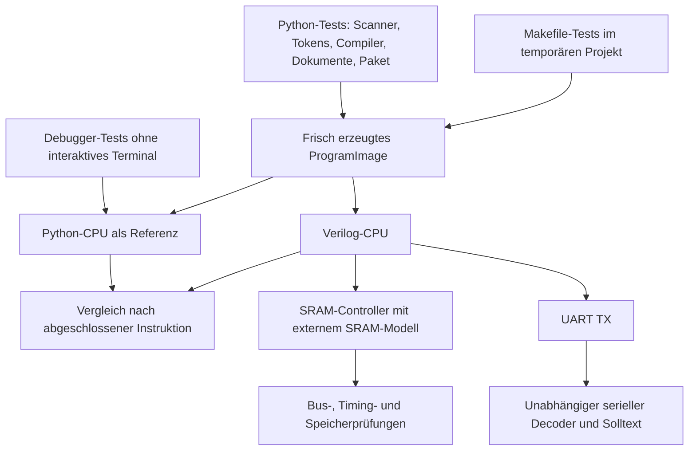
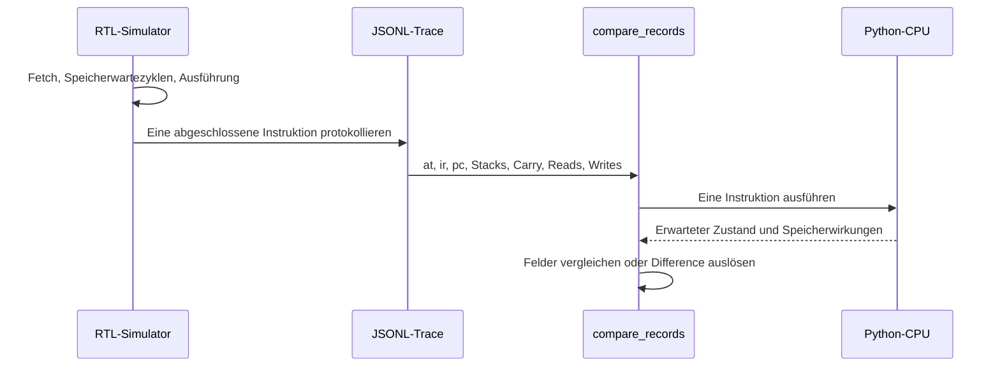

# Tests und Verifikation

Diese Datei beschreibt Testaufbau, Ausführung, Prüfkriterien und Grenzen.
Die eigentliche [Codearchitektur](CODE.md) steht in einem eigenen Dokument;
[system/README.md](../system/README.md) enthält weitere Details zu den Hardwarefällen.

## 1. Welche Ebenen werden geprüft?



Die Teststrategie kombiniert Vergleiche mit der Python-Referenz und unabhängig
vorgegebene Ergebnisse. Python und RTL könnten denselben Fehler besitzen;
deshalb reichen reine Implementierungsvergleiche allein nicht aus.

## 2. Voraussetzungen und schneller Einstieg

Alle folgenden Befehle laufen vom Repository-Stamm aus, sofern nicht anders
angegeben. Zuerst das lokale Paket installieren und die Umgebung aktivieren:

```sh
bash setup.sh
source .venv/bin/activate
pip install -e '.[debug]'
```

Das Debug-Extra wird nur für Debugger-Tests benötigt. Ohne `blessed` werden diese
Tests übersprungen; die übrigen Python-Prüfungen sollen trotzdem funktionieren.
Für Makefile-Tests wird `make` benötigt, sonst werden auch diese übersprungen.
Amaranth ist für die hier beschriebenen Verilog-Tests nicht erforderlich.

Die Python-Tests mit `unittest`:

```sh
python -m unittest discover -s src -p 'test*.py'
```

Der ältere CPU-Selbsttest ist ein eigenes Skript und wird durch diese Discovery
nicht als Testfunktion ausgeführt. Deshalb zusätzlich aufrufen:

```sh
python src/test.py
```

Für die vollständige CTest-Suite werden CMake, Verilator, Icarus Verilog
(`iverilog`, `vvp`) und ein C++17-Compiler benötigt:

```sh
cmake -S . -B build/sim
cmake --build build/sim
ctest --test-dir build/sim --output-on-failure
```

CMake bevorzugt `.venv/bin/python`, wenn diese Umgebung existiert. Bei Bedarf
lässt sich der Interpreter explizit auswählen:

```sh
cmake -S . -B build/sim -DPython3_EXECUTABLE="$PWD/.venv/bin/python"
```

**CTest baut den Verilator-Simulator nicht neu.** Nach RTL-Änderungen vor CTest
immer `cmake --build build/sim` ausführen. Icarus-Harnesses werden dagegen von
ihren jeweiligen Tests aufgebaut.

## 3. Python-Testdateien

| Datei | Was sie prüft |
| --- | --- |
| [src/test.py](../src/test.py) | CPU-Instruktionen anhand vorgegebener Resultate: Kontrollfluss, ALU, Stack und Speicher |
| [src/test_toolchain.py](../src/test_toolchain.py) | Scanner-/Tokenizerregeln, Diagnosepositionen, Compileraktionen, UTF-8, Immediate-Grenzen und unabhängiger Übersetzungszustand |
| [src/test_artifacts.py](../src/test_artifacts.py) | TOML-Roundtrips, Dokumentrollen, Feldvalidierung, Pufferbesitz, Metadaten und Binärexport |
| [src/test_package.py](../src/test_package.py) | Installiertes Paket, Imports ohne Startnebenwirkungen, CLI-Einstiege, optionale Abhängigkeiten und Assemblerausgabe |
| [src/test_debugger.py](../src/test_debugger.py) | Seiteneffektfreie Inspektion, UTF-8-UART, Bytevalidierung, Reset und gemeldete UART-Dateifehler |
| [src/test_isa.py](../src/test_isa.py) | Alle generierten Opcodewörter, zusammengesetzte Emitter, `boot!` und Exportformate |
| [src/test_build.py](../src/test_build.py) | Makefile-Ausgaben, inkrementelle Neubauten, Parallelbau, gezieltes Clean und Convenience-Targets |

Einzelne Dateien oder Testmethoden lassen sich so ausführen:

```sh
python src/test_artifacts.py
python src/test_debugger.py
python -m unittest discover -s src -p 'test_build.py'
python src/test_toolchain.py ScannerAndContextChecks
python src/test_debugger.py DebuggerChecks.test_inspection_does_not_consume_uart
```

### Scanner, Tokenizer und Compiler

`test_toolchain.py` prüft insbesondere:

- Kommentarzeichen innerhalb von Strings und Anführungszeichen innerhalb von
  Kommentaren werden nicht fälschlich als Syntax behandelt.
- Mehrzeilige Kommentare verlieren die folgende Quellposition nicht.
- Unbekannte Namen, doppelte Definitionen, fehlerhafte Moduswechsel und offene
  Strings liefern verständliche Fehler mit Quellposition.
- Ungültige Token-Tags, abgeschnittene Payloads und falsche Symbolindizes liefern
  Tokenoffsets.
- UTF-8-Längen werden in Bytes gemessen. Zu lange Strings werden abgelehnt;
  kompilierte Strings springen zur Laufzeit korrekt über ihre Daten.
- Wiederholte beziehungsweise abwechselnde Übersetzungen teilen keinen globalen
  Symbol- oder Literalzustand und verändern importierte Bibliotheken nicht.
- Immediate-Ausführung verändert die übergebene Opcodeliste nicht und bricht
  bei Erreichen der Schrittgrenze ab.
- CLI-Fehlerfälle erzeugen keine scheinbar gültigen Ausgabedateien.

Einige Prüfungen starten Unterprozesse mit `python -O`. So wird überprüft,
dass Benutzereingaben nicht ausschließlich durch entfernbare `assert`-Anweisungen
validiert werden. Die Artefaktprüfungen können ebenfalls explizit optimiert laufen:

```sh
python -O src/test_artifacts.py
python -O src/test_toolchain.py
```

### Dokumente und Paketinstallation

`test_artifacts.py` prüft beide TOML-Dokumentrollen und ihre Umwandlung in
Python-Objekte. Dazu gehören falsche Speichergrößen, ungültige Bytewerte,
Symbol-/Adressfelder, zusätzliche Metadaten und unabhängige Rückgabepuffer.
Der Name `,` wird als normaler Symbolname behandelt; leere Namen werden nicht
mehr über einen historischen Komma-Workaround repariert.

`test_package.py` startet Python auch mit `-I` aus einem temporären
Arbeitsverzeichnis. Dadurch können Tests nicht versehentlich nur wegen des
aktuellen Quellverzeichnisses oder eines `PYTHONPATH` bestehen. Die Installation
mit `pip install -e .` und ihre Metadaten müssen tatsächlich vorhanden sein.
CLI-Hilfe wird für Modul- und Console-Einstiege geprüft; der Assembler muss über
beide Wege dieselben erwarteten Bytes erzeugen.

### Debugger ohne interaktives Terminal

`test_debugger.py` verwendet die echten Speicher-/Debuggerklassen, ruft jedoch
keine interaktive Eingabeschleife auf. Ausgaben der Ansichten werden abgefangen.

Der wesentliche Regressionstest stellt UART-Eingabe bereit, zeigt den Bereich
um `0xffff` in Speicher- und Codeansicht und verwendet `r`. Anschließend müssen
die Bytes noch vollständig vorhanden sein. Erst echte CPU-Lesezugriffe dürfen
sie aus der FIFO entfernen. Weitere Fälle prüfen:

- Unicode-Eingabe wird als konkrete UTF-8-Bytefolge gelesen.
- `uart` ohne Text legt nicht versehentlich den Befehlsnamen in die FIFO.
- Reset stellt RAM und ursprüngliche Eingabe wieder her, entfernt interaktive
  Zusätze und temporäre Breakpoints und behält Benutzer-Breakpoints.
- Auch ohne anfängliches Speicherabbild stellt Reset den Ausgangszustand her.
- Ungültige UART-Bytes und Fehler einer expliziten UART-Datei bleiben sichtbar.

Terminal-Layout, Resize-Verhalten und echte Tasteneingaben werden dadurch nicht
vollständig geprüft; dafür bleibt ein manueller interaktiver Durchlauf sinnvoll.

### Makefile ohne Änderungen am Arbeitsverzeichnis

`test_build.py` legt ein temporäres Projekt mit kopierten Quellen an und startet
`make -j2`. Es erwartet die zwölf generierten Dateien unter `build/src/` und
keine TOML-Ausgaben neben den Quellen. Ein unveränderter zweiter Aufruf darf
keine Toolkommandos ausführen.

Anschließend wird jeweils nur der Zeitstempel eines Toolmoduls beziehungsweise
der Projektkonfiguration erneuert. `make -n` muss Tokenisierung, Compilation
und Export neu einplanen; danach wird tatsächlich gebaut. Der Clean-Test legt
zusätzliche TOML-Dateien im Ausgabe- und Quellverzeichnis an. Diese müssen
bleiben, während die benannten Ausgaben entfernt werden.

### Generierte Opcodewörter und Bootstrap

`test_isa.py` erzeugt die Opcodequelle in einem temporären Verzeichnis und
kompiliert Bootstrap, Opcodebibliothek und Basisbibliothek. Jedes generierte
Wort wird tatsächlich im Immediate-Modus ausgeführt: Es muss genau das
zugehörige ISA-Byte schreiben und HERE um eins erhöhen. Die vollständige
Abdeckung sowie bestehende Schreibweisen wie `+,`, `>r,` und `c!,` werden
geprüft. Zusammengesetzte Emitter müssen ihre bisherigen Bytefolgen liefern.

`boot!` wird sowohl auf Speicherwirkung als auch auf ausgeglichene Immediate-
Stacks geprüft. Der erzeugte Einstieg muss ein kleines Programm aufrufen,
das mit 42 auf dem Datenstack hält. CLI-Tests vergleichen TokenForth-Export,
Standarddateinamen und den weiterhin voreingestellten Verilog-Export.

## 4. Die fünfzehn CTest-Suites

Die Registrierung steht in [CMakeLists.txt](../CMakeLists.txt).

| CTest-Name | Einstieg | Schwerpunkt |
| --- | --- | --- |
| `control_flow_regressions` | `control_flow_regressions.py` | Feste Instruktionsprogramme mit unabhängig vorgegebenem Endzustand |
| `python_rtl_comparison` | `compare.py` | Instruktionsweiser Python-/RTL-Vergleich für gemeinsame Vektoren |
| `comparison_checks` | `test_compare.py` | Stackgrenzen, Returnbit-Reihenfolge, ALU-Grenzfälle, Carry und Kontrollfluss |
| `memory_handshake_checks` | `test_memory.py` | Speicherzugriffe mit Wartezyklen, ungerade/wrappende Adressen, selbstmodifizierender Code |
| `sram_controller_checks` | `test_sram.py` | Physischer SRAM-Bus, Timing, Read-modify-write und CPU/SRAM-Integration |
| `uart_io_checks` | `test_io.py` | UART-Einzelmodul, serielle Bytewerte, Grenzübertritte und SRAM/UART-Integration |
| `tokenforth_end_to_end` | `test_tokenforth.py` | Frisch kompilierte TokenForth-Beispiele auf CPU/SRAM/UART sowie Python-Regressionsskripte |
| `debug_uart_checks` | `system/tests/test_debug_uart.py` | Vollständige CPU/SRAM/Debug-Integration |
| `debug_uart_host_checks` | `debug_uart/tests/test_host.py` | Hostprotokoll, BREAK, Kanaltrennung und Timeouts |
| `cpu_debug_checks` | `cpu/tests/test_debug_cpu.py` | HALT/STEP mit Speicherwartezyklen und BREAK.RET |
| `uart_session_checks` | `debug_uart/tests/test_session.py` | Gleichzeitige Kanäle, RX-Flusskontrolle, ununterbrochener Schreibmodus, PTY-Keybindings und Terminal-Restore |
| `uart_component_checks` | `debug_uart/tests/test_rtl.py` | UART RX/TX, Parser ohne CPU/System und TX-Arbitrierung |
| `olimex_host_checks` | `boards/olimex_ice40hx8k_evb/test_host.py` | CPU-Steuerkommandos, 64-KiB-Loader, explizites Überspringen von FFFE/FFFF, Verifikationsfehler und Portfreigabe |
| `olimex_board_checks` | `boards/olimex_ice40hx8k_evb/test_board.py` | Power-up-Halt, Tasterreset und Build-Abbruch bei Timingfehlern |
| `test_harness_checks` | `test_support.py` | Importnebenwirkungen, Prozessfehler, Timeouts, Traces und unabhängige Optionen |

Es handelt sich um Suites, nicht um fünfzehn einzelne Testfälle. Suites enthalten
mehrere Tests und teils viele Unterfälle. Mit `-N` lässt sich die Registrierung
anzeigen; mit `-R` eine Auswahl ausführen:

```sh
ctest --test-dir build/sim -N
ctest --test-dir build/sim -R 'comparison_checks|memory_handshake_checks' --output-on-failure
ctest --test-dir build/sim -R tokenforth_end_to_end --output-on-failure
```

## 5. Was bedeutet „instruktionsweiser Vergleich“?

Python und RTL laufen nicht taktsynchron. Ein Python-Schritt beschreibt die
Wirkung einer vollständigen Instruktion. Die Verilog-CPU benötigt abhängig von
Opcode und Speicherlatenz mehrere Takte. Verglichen wird deshalb erst nach
Abschluss der Instruktion, dem sogenannten Retirement.



`tests/support/reference.py` prüft Instruktionsadresse und Opcode, PC,
Stackzeiger, Carry sowie die geordneten Byte-Lese- und Schreibzugriffe.
Auch belegte Stackwerte werden verglichen. Die Referenz verfolgt dafür eine
belegte Tiefe, statt alle physischen Arrayzellen blind gleichzusetzen.

Unbenutzte Stackzellen werden bewusst ignoriert: Python löscht gepoppte Zellen,
RTL darf alte oder undefinierte Werte behalten. Der Vergleich bildet außerdem
die Reihenfolge von Stackwirkung und zusätzlichem Return ab, einschließlich
Ringpuffergrenzen. Das fügt der CPU keinen Stack-Unterlauftrap hinzu.

BREAK/SIMEND erscheinen als Halt-Eintrag. Beim Tracevergleich werden die Marken
nicht mehr ausgeführt; beide PCs zeigen noch darauf. Das unterscheidet sich
von einem direkten `Prim.step()`, das den Opcode bereits geholt und den PC
erhöht hat. Ein fehlender Halt, zusätzliche Daten nach Halt oder ein erreichtes
Instruktionslimit sind Fehler.

## 6. SRAM- und UART-Prüfungen

Icarus simuliert den SRAM-Bus einschließlich hochohmiger und undefinierter
Signalzustände. Damit lassen sich Konflikte erkennen, die ein reiner
Python-Speicher nicht abbildet. Die Testbench überprüft unter anderem
Busfreigabe, Steuerleitungen, Read-modify-write, Datenerhalt benachbarter Bytes
und Adressüberlauf.

Die gemeinsamen Timingvarianten stehen in `tests/support/paths.py`:

| READ_CYCLES | WRITE_CYCLES | SRAM_DELAY_NS |
| --- | --- | --- |
| 1 | 1 | 3 |
| 2 | 2 | 12 |
| 3 | 4 | 19 |

Diese Kombinationen sind Simulationsfälle, keine Bestätigung eines realen
Board-Timings. CPU-Tests gegen das Verilator-Modell ergänzen feste und
reproduzierbare pseudozufällige Speicherwartezeiten.

Die UART-Testbench decodiert das serielle TX-Signal. Die erhaltenen Bytes
werden mit der Python-TX-Referenz verglichen; TokenForth-Beispiele besitzen
zusätzlich feste erwartete Texte. Geprüft werden auch Wortschreibzugriffe,
bei denen ein Byte an UART und das andere an SRAM geht.

## 7. End-to-End: von .cf bis zum seriellen Ausgang

`TokenForthBuild.compile_examples()` baut Bootstrap, generierte Opcodewörter
und die Basisbibliothek, dann die
Beispiele frisch in `build/tokenforth/`. Bereits vorhandene Dateien unter
`src/` sind keine Grundlage dieses Tests.

```text
bootstrap.cf → bootstrap.tf.toml
                         ↓ Bibliotheksimport
prim.isa → opcodes.cf → opcodes.tf.toml
                         ↓ Bibliotheksimport
base.cf → base.tok.toml → base.tf.toml
                              ↓ Bibliotheksimport
example.cf → example.tok.toml → example.tf.toml → example.bin
                                                       ↓
                              Verilog-CPU + SRAM + UART TX
                                                       ↓
                                  Tracevergleich + serieller Solltext
```

| Beispiel | Erwartete Ausgabe | Schwerpunkt |
| --- | --- | --- |
| `hello` | `Hello, World!\r\n` | Strings, Aufrufe und Schleife |
| `control` | `BACCC012` | Kontrollfluss und Schleifen |
| `data` | `ABCZ` | Daten und Speicheroperationen |
| `strings` | `Grüße 🙂 Raw ä \\ ( )\r\n` | UTF-8, rohe Strings und Sonderzeichen |

Die Tabelle verwendet `\r\n` als sichtbare Schreibweise für CR/LF.
Jedes der vier Programme läuft mit allen drei SRAM-Timingvarianten.
Außerdem werden Dokumenttypen, Basisbibliotheksübernahme, Bildgröße und der
Startcode `PUSH main; CALL; BREAK` geprüft. UART-Ausgabe während der Übersetzung
wird zurückgewiesen: Die erwarteten Texte sollen erst im laufenden Programm
entstehen.

Die Suite startet zusätzlich `test_toolchain.py`, `test.py`, `test_package.py`,
`test_artifacts.py`, `test_debugger.py`, `test_build.py` und `test_isa.py` als eigene Prozesse.
Ein CTest-Lauf deckt damit auch diese Python-Prüfungen ab, sofern die jeweiligen
optionalen Voraussetzungen vorhanden sind.

Direkter Aufruf ohne Verilator-Build:

```sh
python system/tests/test_tokenforth.py
python system/tests/test_tokenforth.py --compiler-python "$PWD/.venv/bin/python"
```

Die Suite baut ihre Icarus-Simulatoren selbst. Für einzelne Methoden können
`unittest`-Argumente angehängt werden:

```sh
python system/tests/test_tokenforth.py TokenForthChecks.test_artifacts_and_reset_entry
```

## 8. Gemeinsame Testinfrastruktur

| Modul unter `tests/support/` | Verantwortung |
| --- | --- |
| `paths.py` | Repositorypfade, Standard-Simulator und Timingvarianten |
| `config.py` | `Tools`-Konfiguration und Argumente am Skripteinstieg |
| `process.py` | Unterprozesse, Timeouts, erwartete Exitcodes und Logs |
| `build.py` | CMake/Verilator- und Icarus-Aufrufe |
| `reference.py` | Protokollierender Python-Speicher und Retirementvergleich |
| `traces.py` | JSONL einlesen und Endzustand aus Simulatorausgabe lesen |
| `verilator.py` | Binärbild/Trace im temporären Verzeichnis und Vergleich |
| `sram.py` | Icarus-Lebenszyklus, SRAM-Bilder, UART-Ergebnisse und Traces |
| `tokenforth.py` | Compiler-Interpreter auswählen und frische Toolchain ausführen |
| `cases.py` | Gemeinsame feste Instruktionsvektoren |
| `scenarios.py` | Wiederverwendete SRAM-/CPU-Prüfszenarien |
| `unittest_bridge.py` | Kleine Adapter für `setUpClass` und temporäre Ressourcen |

Testmodule importieren keine anderen Testmodule. Hilfsmodule starten beim
Import weder Builds noch Argumentverarbeitung. `test_support.py` sichert das
ab und prüft, dass Fehlerausgaben, Exitcodes und Timeoutinformationen erhalten
bleiben.

## 9. Eigene Fälle untersuchen

Ein kleines Assemblerprogramm gegen einen bereits gebauten Simulator prüfen:

```sh
python cpu/tests/compare.py --simulator build/sim/simulator --asm '1 2 +'
python cpu/tests/compare.py --simulator build/sim/simulator --asm '1 2 +' --wait-cycles 8 --wait-seed 123
```

Bei `--asm` hängt das Werkzeug BREAK an. Ein Binärprogramm benötigt dagegen
bereits einen erreichbaren BREAK- oder SIMEND-Marker:

```sh
python cpu/tests/compare.py --simulator build/sim/simulator --binary build/src/demo.bin --max-steps 1000
```

Verilator-basierte `unittest`-Skripte verlangen beim direkten Einstieg einen
Simulatorpfad, zum Beispiel:

```sh
python cpu/tests/test_compare.py --simulator build/sim/simulator
python cpu/tests/test_memory.py --simulator build/sim/simulator
python system/tests/test_sram.py
python system/tests/test_io.py
python tests/test_support.py
```

Bei einer Abweichung nennt `Difference` Schritt, PC, Opcode und das betroffene
Feld sowie RTL- und Python-Wert. Zuerst die früheste Abweichung untersuchen;
spätere Fehler können nur deren Folge sein. JSON-Parsefehler nennen die
Trace-Datei und Zeile. Fehlende Programme, Simulatoren oder Interpreter sind
Setupfehler und kein Beleg für einen CPU-Fehler.

## 10. Artefakte und Grenzen der Aussage

End-to-End-Artefakte bleiben unter `build/tokenforth/` erhalten: TOML-Dokumente,
Binärbilder, Compilerlogs sowie gespeicherte Retirement-Traces (`.jsonl`) und
UART-Bytes (`.uart.bin`). Die Dateinamen enthalten Beispiel und Lese-/Schreibtiming.
Viele andere Tests verwenden temporäre Verzeichnisse und räumen diese danach auf.

Die Prüfungen belegen Verhalten für die vorhandenen Fälle und Grenzen, keine
vollständige formale Verifikation. Nicht abgedeckt sind insbesondere die
physische Board-Inbetriebnahme, Pinzuordnung, Timing nach Place-and-route und
ein realer Programmlader. UART RX im Debugger ist keine verifizierte RTL-RX-
Implementierung. Der unvollständige On-CPU-Tokeninterpreter wird gebaut, aber
nicht als vollständiger Ersatz des Host-Compilers nachgewiesen.

Ein grüner Lauf mit übersprungenen Debugger-Tests bestätigt deren Verhalten
nicht. Ebenso sind die festen Simulationswartezeiten keine Zusage für eine
bestimmte SRAM-/Board-Taktkonfiguration. Aktuelle Ergebnisse sollten immer mit
dem tatsächlich ausgeführten Befehl und den vorhandenen Werkzeugen berichtet
werden; die Dokumentation hält keine dauerhaft gültige Testanzahl fest.

## FPGA-Debug-UART

`python system/tests/test_debug_uart.py` prüft den vollständigen seriellen Debugpfad.
`python cpu/tests/test_debug_cpu.py` prüft CPU-Halt/Step bei Speicherwartezyklen.
`python debug_uart/tests/test_rtl.py` prüft RX/TX, Parser und TX-Arbiter ohne
CPU- oder Systeminstanzen. `python debug_uart/tests/test_host.py` prüft die
Hostbibliothek. CTest integriert alle vier Einstiegspunkte; insgesamt gibt es
fünfzehn Suiten einschließlich der Olimex-Board- und Host-CLI-Tests. Details zum implementierten Protokoll und zum `synth_ice40`-Vergleich
stehen in [DRAFT.md](DRAFT.md). FPGA-CPU-Ausgaben werden als sieben Nutzbits
verglichen; UTF-8 wird auf dieser Leitung nicht erhalten.
